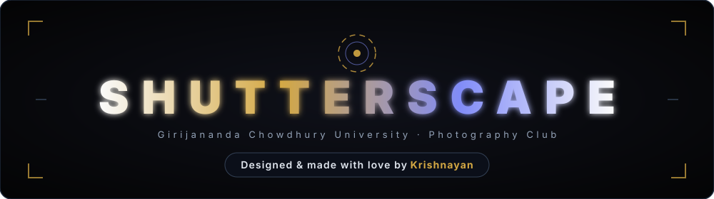
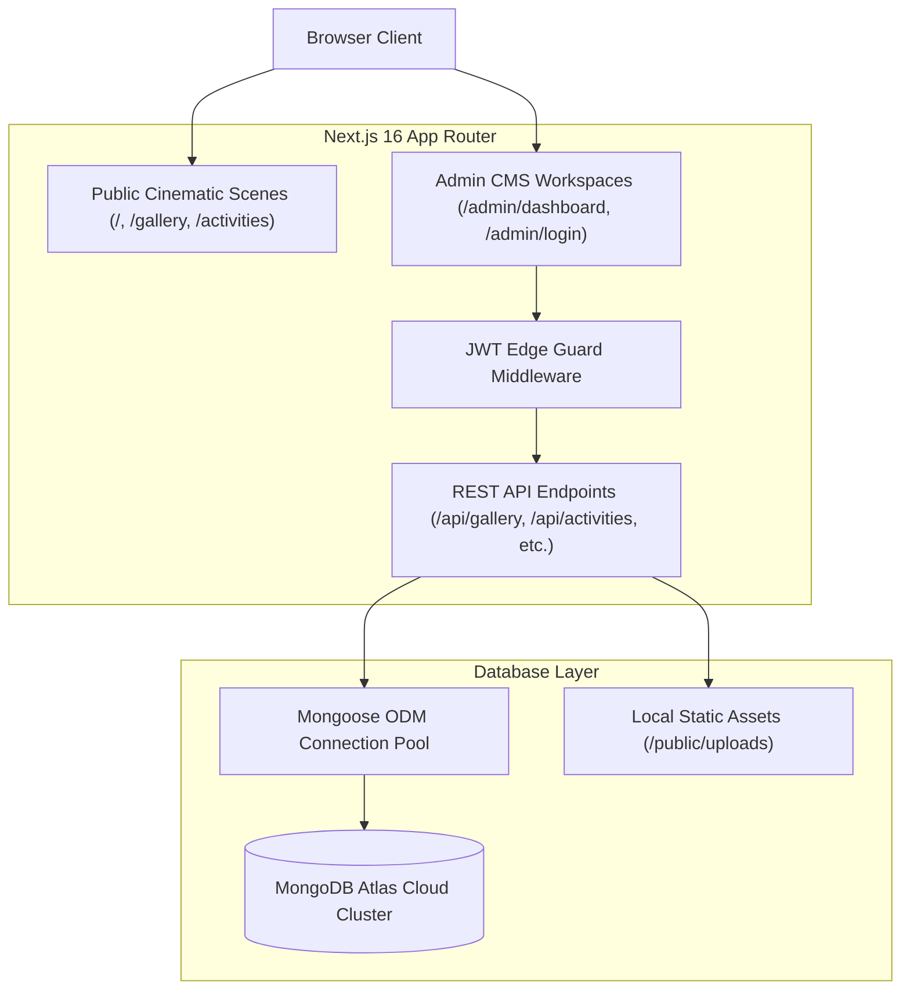

<div align="center">



<br /><br />

[](https://nextjs.org/)
[](https://react.dev/)
[](https://www.typescriptlang.org/)
[](https://tailwindcss.com/)
[](https://threejs.org/)
[](https://greensock.com/gsap/)
[](https://www.mongodb.com/atlas)

<p align="center">
  <a href="#-cinematic-frontend-experience">Cinematic Showcase</a> •
  <a href="#-enterprise-darkroom-cms">Darkroom CMS</a> •
  <a href="#-architecture--tech-stack">Architecture</a> •
  <a href="#-getting-started">Installation</a> •
  <a href="#-environment-variables">Configuration</a> •
  <a href="#-club-roster">Leadership</a>
</p>

---

</div>

<br />

## 🌟 Overview

**ShutterScape** is a state-of-the-art web application engineered for the official photography club of **Girijananda Chowdhury University (GCU)**. Blending analog darkroom aesthetics with cutting-edge 3D WebGL and cinematic scroll choreography, ShutterScape serves as both an immersive public exhibition and an enterprise-grade SaaS content management system.

Every aspect of the platform—from vertical 35mm film contact sheets to high-speed Xenon strobe documentation—is dynamically powered by a **MongoDB Atlas cloud cluster** and manageable via a bespoke **Admin CMS**.

---

## 🎞️ Cinematic Frontend Experience

```
+---------------------------------------------------------------------------------+
|                               SHUTTERSCAPE STAGE                                |
+---------------------------------------------------------------------------------+
|  [SCENE 01]  3D Camera Aperture Hero  -> Flanked by 6 vertical 35mm film strips |
|  [SCENE 02]  Pull-in 3D Depth Tunnel  -> 8 corridor photographic perspective    |
|  [SCENE 03]  Visual Loupe Archive     -> 25 contact frames with EXIF inspection |
|  [SCENE 04]  Activities & Chronology  -> '26 & '25 timeline with live RSVP tags |
|  [SCENE 05]  Frames of Moments        -> Vertical mobile cinema video reels     |
|  [SCENE 06]  Committee Roster         -> 5 leadership chapters & mentors        |
+---------------------------------------------------------------------------------+
```

### Key Highlights
- **WebGL 3D Camera Aperture**: Realistic 3D vintage camera lens model rendered in Three.js with realistic metal roughness, ambient reflections, and interactive mouse-tracking parallax.
- **GSAP ScrollTrigger Depth Corridor**: Smooth scrubbed 3D spatial tunnel pulling the user through 8 high-resolution corridor exhibits.
- **Inspection Loupe Modal**: 1:1 high-resolution zoom inspecting silver-gelatin emulsion textures, photographic film stock (Kodak Tri-X, Portra, Cinestill, Ilford HP5), and precision camera EXIF data (shutter speed, aperture, focal length, ISO).
- **Audio Scape**: Ambient mechanical camera shutter synthesized audio clicks on navigation and background lofi darkroom music player.

---

## 🎛️ Enterprise Darkroom CMS

ShutterScape includes an **isolated, enterprise-grade Content Management System** built after leading SaaS design systems (inspired by WrapPixel and Linear).

```
+-------------------------------------------------------------------------------+
|  SHUTTERSCAPE CMS                                [ Sync ] [ + Add New Frame ] |
|  ---------------------------------------------------------------------------  |
|  [KPIs]  25 Archive Frames | 24 Timeline Events | 17 Members | 20 Scene Reels |
|  ---------------------------------------------------------------------------  |
|  [Search 🔍]  [ All Categories ] [ Documentary ] [ Portraiture ] [ Street ]   |
|                                                                               |
|  +--------------------+ +--------------------+ +--------------------+         |
|  | [16:10 Thumbnail]  | | [16:10 Thumbnail]  | | [16:10 Thumbnail]  |         |
|  | Monsoon Over Brah. | | Chiaroscuro Gaze   | | Himalayan Alpeng.  |         |
|  | By Riky            | | By Pratyashi Das   | | By Akash Boro      |         |
|  | 35MM · F/2.0       | | 85MM · F/1.4       | | 70MM · F/4.0       |         |
|  | [ Edit ] [Delete]  | | [ Edit ] [Delete]  | | [ Edit ] [Delete]  |         |
|  +--------------------+ +--------------------+ +--------------------+         |
+-------------------------------------------------------------------------------+
```

### CMS Workspaces:
1. **Visual Archive**: Curate 35mm and 120 contact frames, film stocks, photographer credits, and loupe essays.
2. **Hero Contact Reel**: Replace the 6 vertical aperture frames (`01A`–`06F`) on the homepage in 1 click.
3. **Corridor Exhibits**: Modify the 8 3D perspective exhibits, headlines, and depth settings.
4. **Committee Roster**: Manage club leadership across Mentors, Leads, Core, Founders, and Legacy chapters.
5. **Activities & Timeline**: Create events across Works '26 and '25, configure dates, locations, and toggle pulsing **LIVE RSVP** badges.
6. **Motion Video Reels**: Upload vertical `.mp4` and `.webm` phone reels directly from your computer with live video previews.

### CMS Architecture:
- **Direct Local File Uploads**: Drag-and-drop media directly from your computer; handled via `/api/upload` saving directly to disk.
- **JWT Edge Guard**: HTTP-only cryptographic session cookies with 7-day expiration and automatic middleware protection.
- **Dual-Engine Persistence**: Automatically runs on resilient offline JSON fallbacks if offline, and seamlessly transitions to **MongoDB Atlas (`● LIVE DB`)** upon connecting.

---

## 📐 Architecture & Tech Stack



| Component | Technology | Description |
| :--- | :--- | :--- |
| **Framework** | Next.js 16.4 (Turbopack) | App Router, Server Components & Route Handlers |
| **Language** | TypeScript 5 | Strict end-to-end typing across schemas and APIs |
| **UI Library** | React 19 | Fast concurrent rendering and batched updates |
| **Styling** | Tailwind CSS v4 | Scoped design tokens and CSS custom variables |
| **3D Rendering** | Three.js | WebGL procedural geometry, PBR shaders, lens optics |
| **Choreography** | GSAP 3 + ScrollTrigger | Scrubbed multi-scene parallax and spatial pinning |
| **Database** | MongoDB Atlas | Free M0 shared cluster with Mongoose 9 ODM |
| **Authentication** | Jose (JWT) + BcryptJS | Salted password hashing & secure edge cookies |

---

## 🚀 Getting Started

### Prerequisites
- **Node.js** 20.x or higher
- **npm**, **pnpm**, or **yarn**
- Modern WebGL-capable browser (Chrome, Safari, Firefox, Edge)

### 1. Clone & Install
```bash
git clone https://github.com/krishnayankashyap/shutterscape.git
cd shutterscape
npm install
```

### 2. Configure Environment Variables
Copy the template configuration:
```bash
cp .env.example .env.local
```

Open `.env.local` and add your settings:
```env
# MongoDB Atlas Cloud Connection String
MONGODB_URI=mongodb+srv://shutteradmin:<password>@cluster0.e7olvae.mongodb.net/shutterscape?retryWrites=true&w=majority

# JWT Auth Secret
AUTH_SECRET=shutterscape-super-secure-darkroom-vault-secret-key-2026

# Initial Emergency Admin Credentials
ADMIN_INIT_USERNAME=admin
ADMIN_INIT_PASSWORD=ShutterScape2026!
```

### 3. Seed Database in 1 Click
Populate all 25 Visual Archive frames, 24 Timeline events, 17 Committee members, and 6 video reels:
```bash
npm run seed-db
```

### 4. Start Development Server
```bash
npm run dev
```

Open [http://localhost:3000](http://localhost:3000) for the public website, or [http://localhost:3000/admin/dashboard](http://localhost:3000/admin/dashboard) for the CMS.

---

## 📁 Repository Structure

```
shutterscape/
├── public/
│   ├── images/              # Optimized static photography & branding logos
│   ├── videos/              # Vertical cinema reels (mp4/webm)
│   └── uploads/             # Direct system uploads directory
├── src/
│   ├── app/
│   │   ├── admin/
│   │   │   ├── dashboard/   # Enterprise CMS Workspace
│   │   │   └── login/       # Administrative JWT Login Gateway
│   │   ├── api/             # RESTful CRUD Routes (gallery, activities, committee, etc.)
│   │   ├── gallery/         # 25-frame visual archive loupe exploration
│   │   ├── activities/      # '26 & '25 timeline & live RSVP registrations
│   │   ├── layout.tsx       # Root layout with fonts & cinematic audio
│   │   └── page.tsx         # Master cinematic 6-scene scroll experience
│   ├── components/
│   │   ├── admin/           # FileUploadZone, Drag-and-drop components
│   │   └── cinematic/       # Three.js viewport, GSAP scroll tracks, branding
│   ├── lib/
│   │   ├── auth.ts          # Jose JWT generation, verification, and bcrypt
│   │   └── db.ts            # Mongoose pooling & 0ms hot-path connection
│   ├── models/              # Mongoose collection schemas
│   └── middleware.ts        # Next.js Edge Auth Route Protection Guard
├── scripts/
│   ├── create-admin.ts      # CLI administrative provisioning engine
│   └── seed-database.ts     # 1-click cloud database migration engine
├── package.json
└── tsconfig.json
```

---

## 👥 Club Leadership (GCU ShutterScape)

| Role | Name | Department |
| :--- | :--- | :--- |
| **Faculty Coordinator** | Dr. Sangeeta Das | Dept. of Mechanical Engineering |
| **Faculty Co-Coordinator** | Dr. Barsha Chhetri | Dept. of Education |
| **Club President** | Uttama Purkayastha | Executive Board |
| **Vice President** | Ikhyt De Neog | Executive Board |
| **Secretary** | Richita Sarma | Executive Board |
| **Photography Lead** | Sohaib Hussain | Core Committee |
| **Darkroom Specialist** | Mahadananda Dutta | Core Committee |
| **Founding Visionaries** | Dheemaan Deka & Subhrajyoti Goswami | Founders Council |

---

<div align="center">

**Developed with precision for Girijananda Chowdhury University (GCU) Photography Club.**  
*Designed and made with love by **Krishnayan** ❤️*  
*Observe. Capture. Tell Stories.*

</div>
